[Home](../index) > [Group Forms](index) > **Form Migration**
***

Form migration moves an existing **My Forms** form into a **Group Forms** tenant. After migration, access to the form is managed through the tenant's CSTAR groups and roles instead of the form's team in CHEFS.

Migration keeps the form, its versions, submissions and drafts. Only *who controls access* changes.

> **Important:** Migration is permanent and cannot be undone. Once a form is migrated, it stays linked to the selected tenant.

## Who can migrate a form

Only users who meet both requirements can migrate a form into a Tenant:

1. they must be a current **Form Owner** of the pre-migrated CHEFS form, and
2. they must belong to a CSTAR group with the **Form Admin** role for the destination Tenant.

The **Migrate to Tenant** action only appears on a form's Manage page when you are in **My Forms** mode and you are an owner of the form. The list of destination tenants only includes tenants where you have the Form Admin role. If you have no such tenant, the page shows *"No eligible tenants available. You must have the Form Admin role in at least one tenant."*

## Best practice migration guide

For teams migrating multiple forms, we recommend appointing a designated migration lead, or a small number of trusted migration leads, to coordinate the migration process. This is especially important when forms are currently owned by different people in CHEFS.

The migration lead should understand:

- the team's destination Tenant,
- the CSTAR groups that will be assigned to the migrated forms, and
- who needs to retain access after migration.

Where needed, we recommend this person be added as a Form Owner on the forms that need to be migrated, and placed in a CSTAR group with the Form Admin role for the destination Tenant.

This approach helps reduce confusion, keeps group assignments consistent, and avoids granting the Form Admin role broadly just so each current form owner can migrate their own form. Current form ownership may reflect how forms were created in CHEFS; the Form Admin role (unique to "Group Forms" in CHEFS) should reflect who is trusted to manage forms for the Tenant going forward.

### Before you start

- **Set up the tenant's groups in CSTAR first.** Create the groups the form will be assigned to, give them the right roles (for example Form Admin, Submission Reviewer, Form Submitter), and add the people who need access. See [Introduction to CSTAR](Introduction-to-CSTAR.md).
- **Review the current form team.** Anyone who should keep working on the form after migration must be a member of one of the groups you assign.
- **Check for BCeID Basic users.** BCeID Basic accounts cannot sign in to tenants and will lose team access after migration.
- **Agree on group names and roles across forms** so that similar forms are assigned to the same groups.

## Migrating a form

### 1. Open the migration page

In **My Forms**, open the form's **Manage** page and select the **Migrate to Tenant** button.

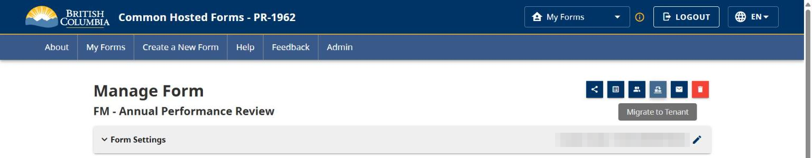

The migration page opens with a reminder that migration is permanent. It shows the form name and the three steps of the migration.

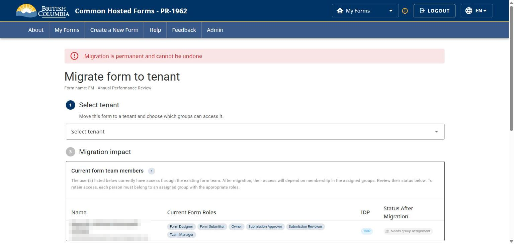

### 2. Select the tenant

Under **Select tenant**, choose the tenant the form will move to. Only tenants where you have the Form Admin role are listed.

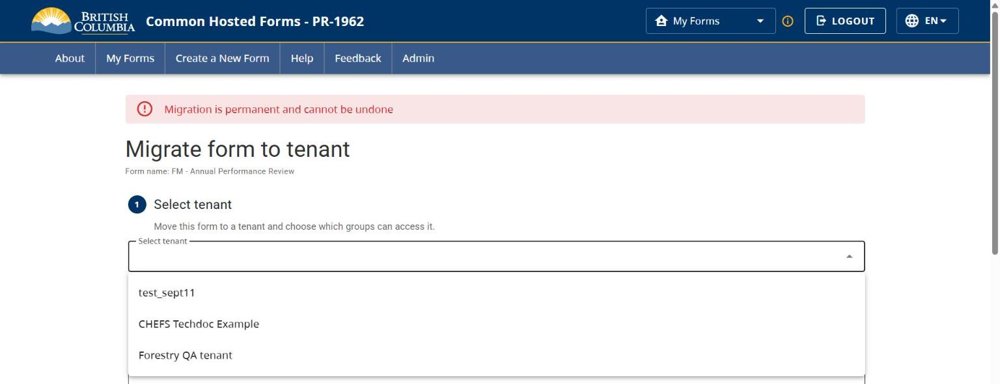

### 3. Assign groups

**Group assignment** lists the selected tenant's groups:

- **Available Groups** are the tenant's groups that are not yet assigned.
- **Assigned to Form** are the groups that will have access to the form after migration. Groups where you hold the Form Admin role are selected for you.
- Each group shows the roles **you** have through it (for example *Form Admin* or *Form Designer*). Roles belong to the group in CSTAR, so every member of a group gets the same roles. Groups you are not a member of show no roles.
- Use the arrow buttons to move groups between the lists, and the refresh icon to reload groups after making changes in CSTAR.

At least one assigned group must have the **Form Admin** role, or no one could manage the form's access after migration. You cannot continue until one is assigned.

**Members of the assigned groups** shows who will have access to the form after migration, and through which groups.

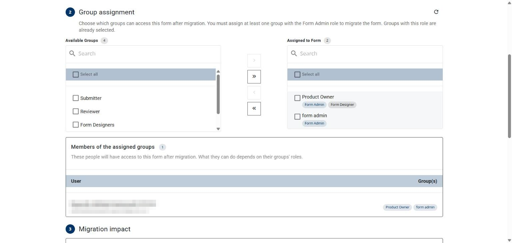

### 4. Review the migration impact

**Migration impact** shows what will change:

- **Current form team members** lists everyone on the form's current CHEFS team, their current form roles, identity provider, the tenant groups they belong to, and their **Status After Migration**:

  | Status | Meaning |
  | --- | --- |
  | Will retain access | The person is a member of at least one assigned group. |
  | Not in assigned groups | The person belongs to tenant groups, but none of them is assigned to the form. |
  | No group membership | The person is not a member of any group in the tenant. |
  | Will lose access | BCeID Basic users cannot sign in to tenants. |

- **Submission Data** shows the number of submitted forms, drafts in progress, and people with access to shared drafts. All of these are kept.

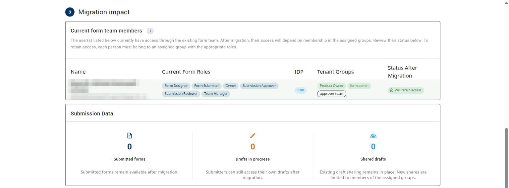

**What to expect after migration** summarizes the effect of migrating:

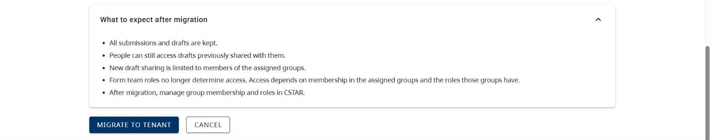

### 5. Confirm

Select **Migrate to tenant**. A confirmation dialog restates the form, the tenant and the assigned groups. Form Admin groups are listed first. If more than three groups are assigned, select **+N more** to see them all.

Select **Migrate form** to complete the migration, or **Cancel** to go back.

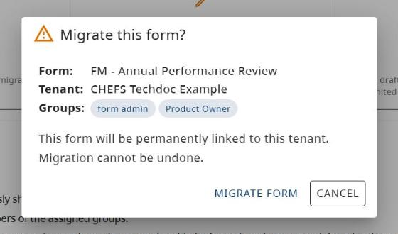

### 6. Migration complete

When the migration succeeds, CHEFS switches you into the destination tenant and shows the **Migration details**: form name, tenant, assigned groups, who migrated the form, and when.

From here you can:

- **Manage form in CHEFS**: open the form's Manage page in the tenant.
- **Manage access in CSTAR**: open CSTAR to manage group membership and roles.
- **Migrate another form**: return to **My Forms** to pick the next form.

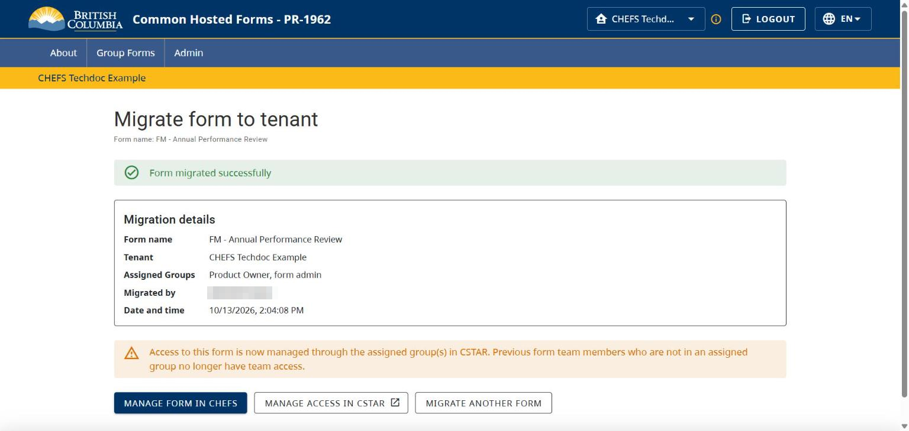

## After migration

### What changes

- **Access is managed in CSTAR.** Form team roles no longer determine access. What a person can do depends on the roles of the assigned groups they belong to. Manage group membership and roles in CSTAR.
- **The form lives in the tenant.** It appears under **Group Forms** for that tenant and no longer appears in **My Forms**.
- **Previous team members** who are not in an assigned group no longer have team access.
- **New draft sharing** is limited to members of the assigned groups.

### What stays the same

- All submissions and drafts are kept.
- Submitters can still access their own drafts, and people can still access drafts previously shared with them.
- The form's design, versions, settings and integrations are unchanged.
- Submitters whose identity provider is allowed by the form can still submit it.

### Identifying migrated forms

Migrated forms show a **Migrated** chip in the Group Forms list and on the form's Manage page. Hovering over the chip on the Manage page shows when the form was migrated and by whom.

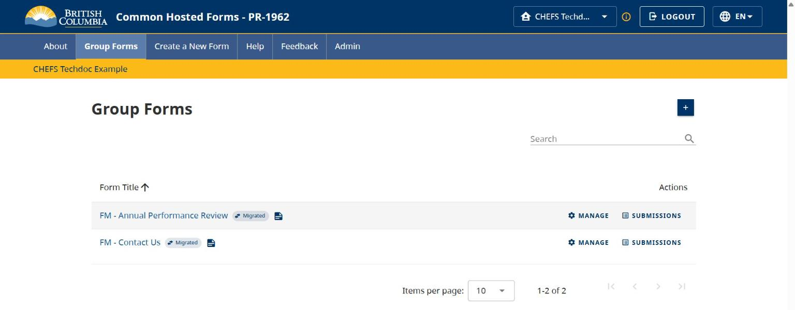

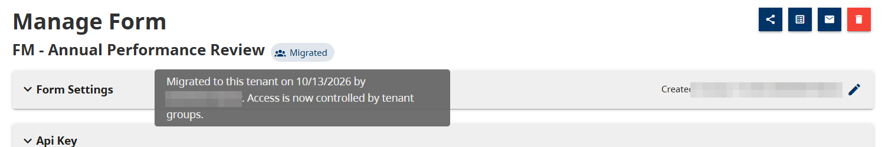

Because a migrated form's access is managed in CSTAR, its Manage page no longer shows the **Team Management** or **Migrate to Tenant** buttons.

If you open a migrated form from an old link or bookmark while in My Forms, CHEFS switches you to the form's tenant and lets you know, as long as you belong to that tenant.

### Opening the migration page again

Opening the migration page for a form that is already migrated shows when it was migrated, to which tenant, and by whom, with links to manage groups or return to the form.

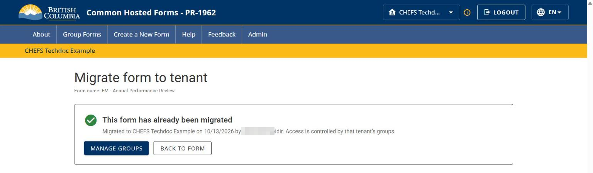

## Troubleshooting

| Message | What to do |
| --- | --- |
| No eligible tenants available. You must have the Form Admin role in at least one tenant. | Ask your tenant administrator to add you to a CSTAR group with the Form Admin role in the destination tenant. |
| At least one assigned group must have the Form Admin role… | Move a group with the Form Admin role into **Assigned to Form**. If none exists, create or update one in CSTAR, then use the refresh icon. |
| Some previously assigned groups are no longer available and have been removed from your selection. | A group was removed or renamed in CSTAR after the page loaded. Review the assigned groups and continue. |
| Your session needed to be refreshed. Please try again. / Your session has expired… | Select **Try Again**, or reload the page and sign in again. |
| The tenant service is currently unavailable / taking too long to respond. | CSTAR could not be reached. Nothing was migrated; try again in a moment. |
| Form is already migrated to a tenant. | Someone else migrated the form while you were reviewing it. Open the form from Group Forms. |

## Technical reference

This section is for developers and support staff.

### API

All endpoints require the tenant feature to be enabled and the `form_update` permission on the form.

| Method | Path | Purpose |
| --- | --- | --- |
| `GET` | `/api/v1/rbac/forms/{formId}/migration/preview` | Eligible tenants, current team impact, submission counts and shared users. Returns the migration record if the form is already migrated. `?refresh=true` bypasses the cached tenant list. |
| `GET` | `/api/v1/rbac/forms/{formId}/migration/tenant-groups?tenantId=` | The tenant's groups with the current user's roles in each (`userRoles`, `isFormAdmin`, `isUserMember`), group members, and the pre-selected Form Admin groups. |
| `POST` | `/api/v1/rbac/forms/{formId}/migration` | Migrates the form. Body: `{ "tenantId": "<uuid>", "groupIds": ["<uuid>", …] }`. |

The `POST` request validates that every group ID belongs to the tenant and that at least one is a Form Admin group the user belongs to. It returns `400` with a `code` of `INVALID_GROUP`, `FORM_ADMIN_GROUP_REQUIRED` or `ALREADY_MIGRATED` for invalid requests. CSTAR failures return `503` (`CSTAR_TIMEOUT`, `CSTAR_UNAVAILABLE`) or `401` (`SESSION_EXPIRED`).

### Data

Migration writes, in a single transaction:

- a `form_tenant` row linking the form to the tenant (`form_tenant.formId` is unique, so a form can only belong to one tenant),
- a `form_group` row for each assigned group, and
- a `form_migration_log` audit row (`formId`, `tenantId`, `createdBy`, `createdAt`).

Migration is additive: existing `form_role_user` and identity provider rows are kept, but they no longer grant management access once the form belongs to a tenant. Concurrent migrations of the same form are serialized with a row lock, and the unique constraint is the final safeguard.

### Configuration

| Setting | Environment variable | Default | Description |
| --- | --- | --- | --- |
| `cstar.timeoutMs` | `CSTAR_TIMEOUT_MS` | `15000` | Timeout for CSTAR calls made during migration. |

***
[Terms of Use](../About/Terms-of-Use) | [Privacy](../About/Privacy) | [Security](../About/Security) | [Service Agreement](../About/Service-Agreement) | [Accessibility](../Capabilities/Accessibility)
